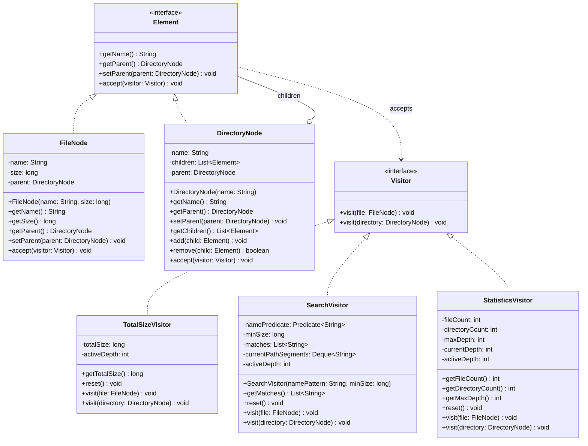

# Assignment 06: Visitor Pattern Report

- **Student:** Maksut Alibi
- **Group:** SE2523
- **Repository URL:** https://github.com/M1ska2021/Assignment6_Visitor

---

## 1. Purpose and Design Choices

The objective of Assignment 06 is to design and implement an in-memory hierarchical file system using the **Visitor behavioral pattern** in Java 17 with Maven. The system separates the hierarchical data structure from arbitrary operational logic, supporting cumulative size calculation, filtered search, and aggregate structural metrics.

### Key Architectural Decisions:
1. **Object Model (`Element`, `FileNode`, `DirectoryNode`):**
   - The tree structure is represented using the Composite pattern. Both `FileNode` (leaf) and `DirectoryNode` (composite) implement the common `Element` interface.
   - Files hold a non-negative byte size and an immutable name. Directories store child elements and coordinate parent-child references.
2. **Double Dispatch Mechanism:**
   - Double dispatch is achieved via two polymorphic invocations:
     1. The client invokes `element.accept(visitor)` on an `Element` reference, dynamically dispatching to either `FileNode.accept` or `DirectoryNode.accept`.
     2. Inside `accept`, the node invokes `visitor.visit(this)`, passing itself as a compile-time statically typed parameter.
   - This routes execution directly to the correct overloaded `visit(FileNode)` or `visit(DirectoryNode)` method without any runtime type discrimination (`instanceof`, `getClass()`, or reflection).
3. **Traversal Ownership (Visitor-Managed):**
   - The visitor controls recursion over child elements inside `visit(DirectoryNode)`.
   - This ensures element classes remain completely decoupled from traversal policies, allowing individual visitors to tailor traversal (e.g., managing depth stacks in `StatisticsVisitor` or path segment queues in `SearchVisitor`).
4. **Controlled State and Reusability:**
   - Visitors prevent stale results across repeated executions. When invoked on a root element (`activeDepth == 0`), visitors automatically re-initialize their internal state. An explicit `reset()` method is also provided.
5. **Tree Invariant Protection:**
   - Negative file sizes, blank element names, and duplicate sibling names are rejected with `IllegalArgumentException`.
   - Multiple parent ownership and cyclic attachments (e.g., adding an ancestor as a child of a descendant) are rejected with `IllegalStateException`.
   - Read-only child views are exposed through `Collections.unmodifiableList()`.

---

## 2. UML Class Diagram



---

## 3. Clean Code Practices

1. **Meaningful Naming:**
   - *Reference:* `TotalSizeVisitor.getTotalSize()` and `DirectoryNode.add(Element child)`
   - *Justification:* Method and class names express exact domain semantics without obscure abbreviations or cryptic shorthand, enabling immediate comprehension of functionality without documentation comments.
2. **Single Responsibility Principle (SRP):**
   - *Reference:* `FileNode` vs `TotalSizeVisitor` / `SearchVisitor`
   - *Justification:* Node classes are exclusively concerned with representing structure and enforcing invariants, while separate analytical and search algorithms reside within dedicated visitor classes.
3. **Small, Focused Methods:**
   - *Reference:* `FileNode.accept(Visitor visitor)` and `DirectoryNode.remove(Element child)`
   - *Justification:* Methods are limited to 2–5 lines, performing a single atomic operation with zero cognitive overhead, which enhances readability and defect isolation.
4. **Encapsulation & Immutability:**
   - *Reference:* `DirectoryNode.getChildren()`
   - *Justification:* Exposes an unmodifiable collection view via `Collections.unmodifiableList()`, preventing external callers from mutating children directly and bypassing parent validation or cycle checks.
5. **Elimination of Type-Checking Chains:**
   - *Reference:* `DirectoryNode.accept(Visitor visitor)` and `FileNode.accept(Visitor visitor)`
   - *Justification:* Leverages polymorphic double dispatch to route execution to the appropriate visitor overload, completely eliminating `instanceof`, `getClass()`, and downcasting branching.

---

## 4. Architectural Trade-offs

### Traversal Ownership
- **Visitor-Managed Traversal (Selected):** Each visitor dictates recursion in `visit(DirectoryNode)`. This grants visitors complete control over traversal state (e.g., maintaining path queues in `SearchVisitor` and depth counters in `StatisticsVisitor`) and leaves element classes minimal.
- **Element-Managed Traversal (Alternative):** Having `DirectoryNode.accept` iterate its children forces all visitors to follow an identical traversal strategy, stripping individual visitors of custom traversal logic.

### Extension Trade-off: Adding Operations vs Adding Element Types
- **Adding Operations (Easy):** New visitors (such as `StatisticsVisitor` or future `JsonExportVisitor`) are added as independent classes implementing `Visitor`. Neither `Element`, `FileNode`, nor `DirectoryNode` require modification (Open/Closed Principle).
- **Adding Element Types (Hard):** Adding a new concrete node (e.g., `SymlinkNode`) requires modifying the `Visitor` interface by declaring `void visit(SymlinkNode symlink)` and updating all concrete visitor classes to implement it, creating cross-cutting changes across the entire visitor family.

---

## 5. Sample Program Output

```text
=== Visitor Pattern Demonstration ===
Root directory: portfolio

--- TotalSizeVisitor ---
Subtree size: 71570 bytes

--- SearchVisitor (.java, minSize >= 1000) ---
Match: src/main/App.java

--- SearchVisitor (all files, minSize >= 10000) ---
Match: docs/architecture.png
Match: docs/specification.pdf

--- StatisticsVisitor ---
Total files: 8
Total directories: 7
Maximum tree depth: 3

--- Verification of Reusability (No State Leakage) ---
Re-run size visitor: 71570 bytes
Re-run statistics files: 8, dirs: 7, depth: 3

--- Invariant Defense ---
Caught duplicate sibling name: Duplicate sibling name: README.md
Caught cycle detection: Cycle detected: cannot add ancestor as child
Caught negative size: File size cannot be negative: -10
```

---

## 6. Automated Test Suite Summary

- **Test Class:** `kz.aitu.se2523.visitor.FileSystemVisitorTest`
- **Runner:** JUnit 5 via Maven Surefire Plugin 3.2.5
- **Execution Command:** `mvn clean test` (or `./mvnw clean test`)

| Check | Test Method Name | Verification Target | Status |
|---|---|---|---|
| **T1** | `t1_bothElementTypesReachCorrectOverloadedVisitMethods` | FileNode and DirectoryNode dispatch to overloaded visit methods | **PASS** |
| **T2** | `t2_sizeAccumulationAcrossMultipleNestingLevelsIsCorrect` | Recursive byte size summation across 3 nesting levels | **PASS** |
| **T3** | `t3_searchCorrectlyCombinesBothConfigurableFilterConditions` | Simultaneous filtering by filename substring and minimum size | **PASS** |
| **T4** | `t4_searchProducesCorrectDeterministicRootRelativePaths` | Lexicographically sorted root-relative paths with `/` separator | **PASS** |
| **T5** | `t5_statisticsAreCorrectForNestingCountingAndMaximumDepth` | File count, directory count (including root), and maximum depth | **PASS** |
| **T6** | `t6_emptyStructuresAndNoMatchSearchCasesAreHandled` | Empty directory traversal and empty search result lists | **PASS** |
| **T7** | `t7_repeatExecutionsDoNotLeakOrMultiplyAccumulatedState` | Idempotent repeat runs without state leakage | **PASS** |
| **T8** | `t8_invalidTreeMutationsAreRejectedWhileValidNestingRemainsSupported` | Defense against negative sizes, duplicates, multi-parent, and cycles | **PASS** |

**Summary:** 8 / 8 Tests PASSED (100% Success Rate, 0 failures, 0 errors, elapsed time: 0.021s).
